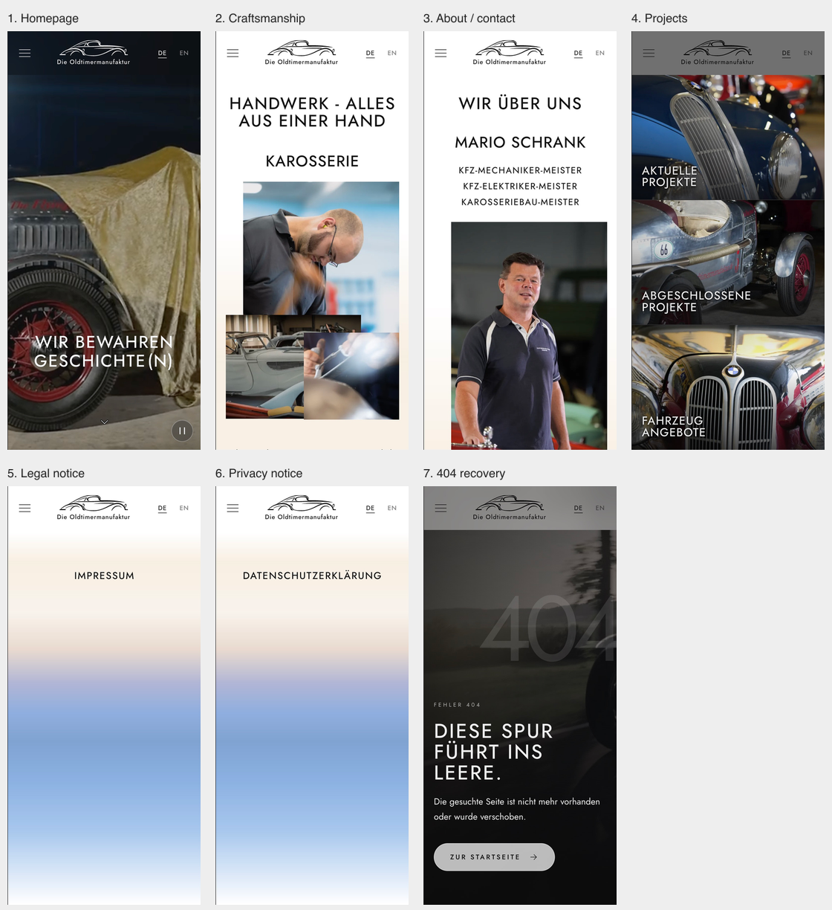
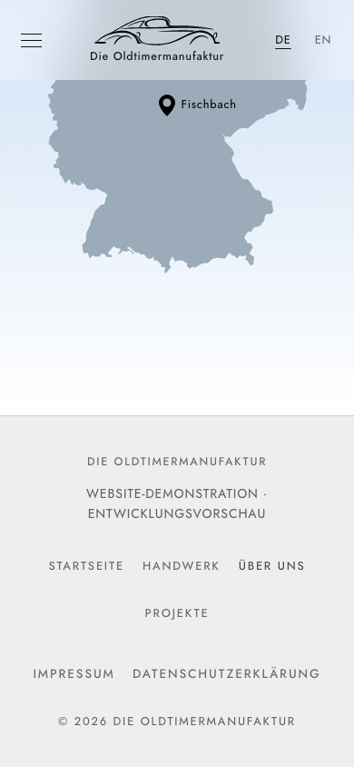
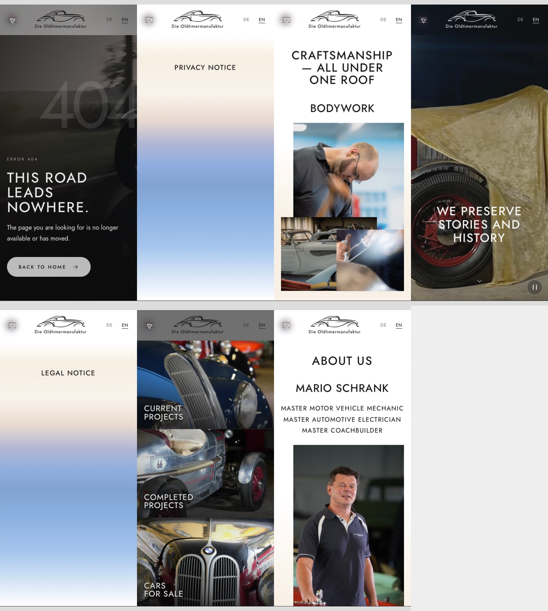
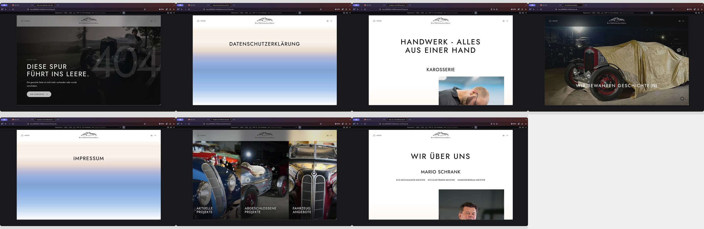

# Site audit and repair — 10 October 2026

The retained demonstration pages passed the final layout, navigation, language, CSP and motion checks described below. The audit used the generated production-format site at `127.0.0.1:4399`, plus a local playback harness. Nothing was deployed.

## Audited steps

| Step | Surface and general health | Findings and final behavior | Screenshot |
| --- | --- | --- | --- |
| 1 | Homepage — passed | Four photographic sections, readable overlays, page links, language switching and animation controls checked. Normal, reduced-motion, blocked and late playback scenarios pass. | [Homepage](01-home.png) |
| 2 | Handwerk — passed | Editorial sections and crops checked at desktop and mobile widths. Direct section links place headings below the fixed header. Content remains readable without JavaScript. | [Handwerk](02-handwerk.png) |
| 3 | Über uns / contact — repaired and passed | Contact labels previously broke into fragments at intermediate widths. Labels now keep their words intact; contact rows stack on narrow screens. Telephone and email link destinations retain their existing schemes. | [About](03-ueberuns.png) |
| 4 | Projekte — repaired and passed | “Abgeschlossene” previously broke across lines in the tablet triptych. Heading size now follows each panel’s width. All three panels remain intentionally noninteractive. | [Projects](04-projekte.png) |
| 5 | Impressum — expected demonstration placeholder | Heading, chrome, language pair and noindex metadata pass. The intentionally empty legal content was preserved. | [Legal notice](05-impressum.png) |
| 6 | Datenschutz — repaired; expected demonstration placeholder | The long German heading previously broke at phone widths. It now fits at 390px and 320px. The intentionally empty legal content and noindex metadata were preserved. | [Privacy](06-datenschutz.png), [native Firefox at 320px](firefox-320-privacy.png) |
| 7 | 404 / return home — passed | Readable error state and localized home link checked. Built output retains noindex, omits canonical/JSON-LD, and includes Apache `ErrorDocument 404 /404.html`. | [404](07-404html.png) |

Shared navigation also needed two fixes: mobile footers now expose the four main page links with at least 44px link heights, and the system-pointer setting only appears when a desktop fine pointer is available. Hidden settings are excluded from the menu focus loop. Escape closes the menu and restores focus; closed content remains inert. A live pointer-availability regression test covers modern and legacy media-query listeners.

The footer now visibly identifies the development demonstration in German and English. Its text no longer participates in the editorial fixed-header scroll-offset calculation.

## Verification

- Native Chrome, Safari and Firefox: all seven retained pages, both languages, desktop and 390px responsive views. Saved and inspected 84 route captures, with additional menu, narrow-screen and playback observations. Firefox was also checked at an applied 320 × 568 viewport for the privacy heading and menu.
- Chromium and WebKit: 120 editorial/legal/404 route cases at 1440 × 900, 390 × 844, 320 × 568, 800 × 600 and 844 × 390, both languages. Assertions cover overflow, wrapping, header/brand geometry, visible footer links, menu focus containment/restoration, inert states, CSP and browser errors.
- Homepage: 16 engine/viewport/language cases, including short landscape screens, all four panel bounds and menu behavior.
- JavaScript disabled: 56 engine/viewport/language/route cases. Text, headings and footer navigation remain available, with no horizontal overflow. Direct editorial hash destinations checked in both engines and languages at desktop and phone widths.
- Motion: 32 engine/viewport/page/scenario cases covering normal, reduced, blocked and late playback. Manual play/pause, decoder suspension and late promise races pass. Successful Chromium autoplay and reduced-motion manual playback do not request animated fallbacks. WebKit’s initial autoplay refusal is handled by the existing fallback; real activation starts video playback. Native Safari’s play/pause controls were checked with real clicks.
- All ten retained MP4 files pass ffprobe checks: exactly one H.264 video stream, 8-bit yuv420p, fast-start metadata, and no audio/subtitle/data streams.
- `npm test`: 39 passing regression tests.
- `npm run crawlers:sync`: eight retained indexable language routes; manual `llms.txt` updated and `robots.txt` reviewed.
- `npm run build:pages` and `npm run build`: pass CSP, language, metadata, accessibility, links and artifact checks. Tracked source hashes remain unchanged by the checks/builds.
- Dependency repair: patched `source-map-js` to 1.2.2 and `http-cache-semantics` to 4.3.0; pinned the audit-recommended `gh-pages` 6.1.1 to remove the vulnerable braces dependency chain. The [braces advisory](https://github.com/advisories/GHSA-vfj7-8cjw-p6xm) has no patched braces release. The publishing command’s CLI options remain available; no publishing command was run.
- `npm run security:check`: zero reported vulnerabilities; 245 package registry signatures and 70 attestations verified.

## Limits

Mobile checks use browser responsive modes and emulation, not physical phones or tablets. The bundled automated Firefox binary could not launch in this environment; installed Firefox was tested through its native UI. Native Safari and automated WebKit are separate test surfaces, and automatic playback depends on browser policy; fallback and manual playback were checked rather than changing user browser preferences.

This is a local demonstration audit, not a guarantee of perfection, a full assistive-technology/WCAG certification, or verification of live hosting and Apache behavior. Contact handlers were inspected without placing calls or sending email. No conversion analytics or real client testing was available. Legal pages remain placeholders as instructed; factual/legal/media approval and actual hosting remain release prerequisites.

The full local capture collection and diagnostic results remain under `.codex-qa/site-audit/`; this report retains a compact, reviewed screenshot set. Existing unrelated working-tree changes were preserved.
